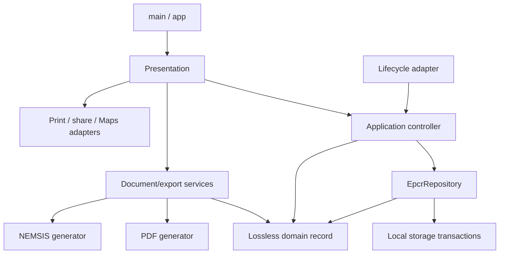

# PVFD ePCR — Milestone 2 architecture

Date: October 22, 2026 (America/Phoenix).

Milestone 2 separates the existing application into explicit layers without a new framework, dependency, JSON schema, Android package/signing change, or UI redesign. The Milestone 1 audit remains historical and unchanged. No Git initialization, commit, publication, patient-record deletion, tablet installation, or access to patient files was performed.

## 1. Inspection and baseline

The actual starting entry point was `pvfd_epcr/lib/main.dart` (2,142 lines), not the original pre-Milestone-1 source. Its only active project import was `lib/services/epcr_storage_service.dart`. The source tree also contained unused `main_old.dart` (counter scaffold), `main_sha.dart` (earlier UUID/storage implementation), and `main_last_20260701.dart` (older clinical application). Their imports, entry points and storage paths were inspected; none is imported by the active application. They remain untouched, and should not be selected as build targets.

The starting `PCRFormPage` state owned every persistent TextEditingController, patient/incident/clinical selections, vitals, current identity, raw original/baseline JSON, dirty revision, record file future, 750 ms timer, lifecycle observer, PDF layout, XML mappings, export file creation, sharing, printing, Maps, and list navigation. `PCRListPage` was in the same file. The storage service independently owned ordered atomic replacement, exclusive creation reservations, ID generation, JSON helper functions, listing and orphan detection.

Baseline commands completed before refactoring: `flutter analyze` reported no issues; `flutter test` passed all 25 cases. Both were rerun after domain/storage extraction and after document extraction; all 25 still passed at each checkpoint.

Existing coverage: 12 storage tests and 13 form cases covered PMH, malformed/legacy records, unknown fields, ordering/failures, unique creation, record switching, lifecycle flushing and PDF/XML generation. Form cases reached private widget State methods through dynamic access; they now use an injected public `EpcrController` while retaining their original assertions and scenarios.

Dependencies remain the existing Flutter SDK, pdf, printing, xml, share_plus, cupertino_icons, path_provider, uuid, url_launcher, flutter_test and flutter_lints. No Provider, Riverpod, Bloc, Redux, DI framework, cloud client or new package was added. `pubspec.yaml` and dependency versions were not intentionally changed.

## 2. Implemented structure and responsibilities

```text
pvfd_epcr/lib/
  main.dart                               # runApp only
  app/pvfd_app.dart                       # existing MaterialApp/theme/title
  core/epcr_id.dart                       # unchanged secure timestamp IDs
  domain/
    models/epcr_record.dart               # lossless record and detached projections
    models/record_json.dart               # existing safe projections/PMH/merge helpers
    validation/epcr_validator.dart        # existing Forest Land/GPS rule
  data/
    repositories/epcr_repository.dart     # abstraction and local implementation
    storage/epcr_storage_service.dart     # unchanged transaction implementation
  application/
    controllers/epcr_controller.dart      # sole editing state and save coordinator
    services/epcr_lifecycle_service.dart  # binding observer -> controller flush
  presentation/
    screens/epcr_editor_screen.dart       # existing editor layout, menus, UI messages
    screens/epcr_list_screen.dart         # existing report-list layout/navigation
    widgets/epcr_field.dart               # field formatting; borrows controllers
    widgets/pmh_section.dart              # PMH UI and display-filter ownership
    widgets/responders_section.dart       # responder UI and display-filter ownership
    widgets/add_vitals_dialog.dart        # dialog-owned text-controller lifecycle
  services/
    pdf_service.dart                     # unchanged PDF layout -> bytes
    nemsis_service.dart                  # unchanged mappings -> XML
    document_export_service.dart         # existing file destinations/names/writes
    printing_service.dart                # Printing.layoutPdf adapter
    sharing_service.dart                 # native PDF/XML share adapter
    maps_service.dart                    # external HTTPS Maps adapter
    epcr_storage_service.dart            # compatibility exports, no duplicate logic
```

Related Incident, Patient and Clinical projections are intentionally kept beside EpcrRecord rather than scattered into mostly empty files. No Responder entity was added: responders remain their existing string codes. The remaining GCS, contacts, forest/GPS and form-completion layout helpers are coherent presentation methods in the editor. The unreferenced SignaturePainter from the old active file was not carried over; no active signature-drawing workflow existed. The printed Completed By, signature and date lines remain.

### Dependency direction



Domain has no Flutter, filesystem, platform-plugin or presentation dependency. PDF generation depends on the existing pdf package and domain helpers; XML generation depends on the existing xml package and domain helpers. Neither generator knows about the screen/controller or platform integrations. The application controller uses built-in ChangeNotifier and TextEditingController, plus the repository abstraction and domain/core types; it has no BuildContext or widget instances. The lifecycle adapter is the only application component that registers with WidgetsBinding.

`EpcrRepository` and `LocalEpcrRepository` share one data-layer file to keep this small application's abstraction and implementation easy to locate. The editor constructs default dependencies (or accepts a repository/controller factory for tests) and owns their lifetime. Integration callbacks are injected through constructors when testing; native plugin implementations remain the defaults. There is no service locator or global mutable form state.

## 3. Domain and compatibility

`EpcrRecord` privately holds a deep JSON copy. `fromJson`, `decode`, `toJson` and `encode` are independently testable. `toJson` and typed projections return detached copies; editing them cannot silently mutate the authoritative original. Source path is retained separately as metadata and never serialized as a clinical field. `_filePath` remains the reserved Milestone 1 list metadata key.

Incident, Patient and Clinical expose safe display projections while preserving the full raw object. Unsupported values are not normalized into a strict schema. All additional fields, original types, legacy PMH locations and malformed-but-recoverable values remain available in the raw record. No mandatory field was introduced.

`applyEdits` owns the existing differential-merge policy and unknown-PMH retention. A controller keeps the original record and a deep baseline of its supported form projection. Only fields changed relative to that baseline are applied. Clinical PMH takes precedence over legacy incident PMH when valid (including an empty array). The existing None interaction remains exclusive among visible options; unsupported historical PMH strings remain in storage. Explicitly editing an unsupported/malformed field may replace that field's old representation, as documented in Milestone 1.

Historical identifiers, filenames, source paths, JSON field names and nesting are unchanged. No historical migration or rename is performed. Existing Android application ID, package, permissions, backup settings and signing configuration are unchanged in this milestone. No schema validation or clinical-value normalization occurs merely because a report is listed or opened. New-record status is explicit: a loaded empty JSON object remains an existing record bound to its original path, without inserting invented persisted identifiers.

## 4. Editing and autosave flow

1. Text widgets borrow their field controllers from one EpcrController. Selection widgets update that same controller's selections and request autosave. There is no duplicate authoritative patient/clinical state in the screen.
2. Text listeners or selection callbacks mark dirty, increment revision and restart the existing 750 ms debounce. ChangeNotifier reports dirty/loading/saving/error state without adding UI indicators or changing layout.
3. On save, the controller applies edits to the original lossless record and captures an independent record, identity, creation fallback, revision and original location future **before awaiting**.
4. New records go through repository creation. The storage service owns secure IDs, exclusive reservation files, collision checks/retries and atomic writes. The controller binds the creation future immediately; overlapping saves cannot accidentally create another destination for the same form.
5. Existing records are saved to their bound original source path. The repository converts the model to JSON and delegates to the unchanged storage transaction. Snapshots are serialized at request time; per-path queues remain shared across service instances within the app isolate.
6. A successful older write cannot clear a newer edit. A failed save retains dirty state, clears saving state and reports a generic failure through the flush/UI boundary. Retry continues through the same mechanism.
7. New/Open first flush all dirty revisions. Failure prevents the switch. Loading projects fields with listeners suppressed, records a deep baseline and leaves dirty false; it does not write the record. Listing remains non-destructive and isolates damaged files.

The low-level `EpcrStorageService` class was verified textually identical to its pre-refactor implementation after moving. Same-directory temporary writes, flushing, rename replacement, reservations, queue recovery after failure, safe platform rejection, orphan behavior and no-delete-first policy are preserved. ID generation was moved unchanged to core, and raw JSON helper functions were moved unchanged to domain. The legacy storage import path re-exports these symbols for compatibility, rather than implementing a second persistence path.

### Lifecycle and ownership

The screen attaches EpcrLifecycleService; inactive/background/detached events request the controller's failure-contained flush. The screen detaches the observer and removes its listener before disposing its controller. Controller disposal captures any final pending snapshot before disposing text fields, cancels the timer, suppresses late callbacks/notifications, and contains asynchronous failures. Pending New/Open continuations check disposal before accessing fields.

The Add Vitals dialog now has a dedicated StatefulWidget owning its six controllers. They are disposed by that widget's State after route removal, rather than leaked or disposed immediately when showDialog completes while closing animations may still rebuild descendants. Dialog Save passes a completed map back to the authoritative controller.

PMH and responder widgets own only Show All/Show Selected display flags. AutomaticKeepAlive preserves those flags when the long editor scrolls them out of view; selections remain in the controller. Generic field widgets never dispose borrowed controllers.

Android can still terminate the process before debounce/background work finishes. This refactor does not add directory fsync, multi-process conflict resolution, a journal or durable pending-edit recovery. Existing committed-record protection and conservative orphan retention remain unchanged.

## 5. Every clinical-data boundary

| Boundary | Responsibility |
| --- | --- |
| Editor/section widgets and vitals dialog | Read controller fields for display; write text/selections/vital rows through their defined owner. |
| EpcrController | Project loaded raw JSON into existing fields; build current form projection; track edits/revision/location; capture stable save/document snapshots. |
| EpcrRecord / record_json | Lossless JSON copies, detached projections, legacy PMH and differential edits. |
| EpcrRepository | Create/load/list/save models, retain original path, pass malformed-file notifications and orphan counts. No deletion API. |
| EpcrStorageService | Encode/decode JSON; read/list files; atomic record writes, temporary/reservation management. |
| PDF/NEMSIS services | Read only the supplied detached snapshot to generate document bytes/text. |
| DocumentExportService | Write requested PDF/XML files to the same private persistent/cache Exports paths as before. |
| List screen | Read names, age, address and ID for the existing list display; return selected record metadata. |
| Sharing/printing | Pass file URI/document bytes and existing ID-based labels to native plugins; no record edits. |
| Maps | Pass only the explicitly requested incident address to the same external HTTPS Maps search. |

No remote storage, diagnostics containing clinical values, telemetry, analytics, encryption, authentication or record deletion was added.

## 6. Documents and integrations

### PDF

A successful `autoSavePCR` now returns the detached EpcrDocumentSnapshot associated with that save request, including its final bound creation ID and captured creation fallback. Export actions use that result rather than re-reading form controls after asynchronous save/generation work. This prevents a later edit, switch or widget disposal from changing which patient's snapshot is rendered. The editor stops launching actions if it has unmounted after saving.

PdfService accepts the snapshot's JSON and generates bytes using the original layout body unchanged apart from its method name/formatting. It retains letter page size, margins, section order, field formatting, vitals, GCS, Completed By and signature/date lines. DocumentExportService owns the existing directory/filename creation and writes. PrintingService separately forwards the bytes to Printing.layoutPdf.

### NEMSIS

NemsisService receives JSON plus explicit captured ID and creation fallback. The XML builder, escaping, order, mappings, UUID algorithm and placeholders are preserved. DocumentExportService writes XML to the same destinations. SharingService forwards the existing subject/text and file to share_plus. Native sharing is not coupled to XML generation.

This is NEMSIS-oriented XML, **not a verified NEMSIS 3.5.1-compliant implementation**. Agency placeholders, 32-bit-hash UUID generation limitations, incident-number-versus-record identity, incomplete standards mappings and missing official national/Arizona XSD/Schematron validation remain for a dedicated future milestone. Those issues were not silently corrected during extraction.

### External APIs and retention

Printing still uses the existing native layoutPdf flow. PDF/XML sharing still uses Share.shareXFiles and the existing subjects/messages. Maps still uses an escaped HTTPS Google Maps search with externalApplication launch mode. APIs are small and constructor-injectable for tests. Offline editing/storage/generation remain independent of these handoffs.

No automatic export cleanup or URI grant changes were implemented. Persistent/cache export locations, partial-export failure behavior, recipient-controlled copies and pinned sharing-plugin permission risks remain as described in the historical audit. A dedicated retention/sharing design is still needed.

## 7. Complete changed-file inventory

Paths below are relative to the workspace root. Generated ignored build/cache/plugin outputs may also be refreshed by Flutter commands.

| Path | Status and purpose |
| --- | --- |
| `pvfd_epcr/lib/main.dart` | Modified: six-line application initialization. |
| `pvfd_epcr/lib/app/pvfd_app.dart` | Created: existing app/title/theme shell. |
| `pvfd_epcr/lib/core/epcr_id.dart` | Extracted: unchanged secure timestamp ID generation. |
| `pvfd_epcr/lib/domain/models/record_json.dart` | Extracted: unchanged safe JSON/PMH/merge helpers. |
| `pvfd_epcr/lib/domain/models/epcr_record.dart` | Created: lossless record, projections, document snapshot and merge policy. |
| `pvfd_epcr/lib/domain/validation/epcr_validator.dart` | Extracted: existing conditional Forest Land/GPS rule. |
| `pvfd_epcr/lib/data/storage/epcr_storage_service.dart` | Moved implementation: unchanged low-level storage class. |
| `pvfd_epcr/lib/data/repositories/epcr_repository.dart` | Created: repository abstraction and local adapter. |
| `pvfd_epcr/lib/services/epcr_storage_service.dart` | Modified: compatibility exports only. |
| `pvfd_epcr/lib/application/controllers/epcr_controller.dart` | Created/extracted: authoritative editing and autosave workflow. |
| `pvfd_epcr/lib/application/services/epcr_lifecycle_service.dart` | Extracted: binding observer/flush adapter. |
| `pvfd_epcr/lib/presentation/screens/epcr_editor_screen.dart` | Extracted: editor layout, UI messages/navigation and action orchestration. |
| `pvfd_epcr/lib/presentation/screens/epcr_list_screen.dart` | Extracted: existing list layout and selection. |
| `pvfd_epcr/lib/presentation/widgets/epcr_field.dart` | Extracted: existing field formatting and borrowing contract. |
| `pvfd_epcr/lib/presentation/widgets/pmh_section.dart` | Extracted: PMH interaction and persistent display filtering. |
| `pvfd_epcr/lib/presentation/widgets/responders_section.dart` | Extracted: responder interaction and persistent display filtering. |
| `pvfd_epcr/lib/presentation/widgets/add_vitals_dialog.dart` | Extracted: vitals dialog with explicit controller ownership/disposal. |
| `pvfd_epcr/lib/services/pdf_service.dart` | Extracted: original PDF generation/layout. |
| `pvfd_epcr/lib/services/nemsis_service.dart` | Extracted: original NEMSIS-oriented generator. |
| `pvfd_epcr/lib/services/document_export_service.dart` | Extracted: existing PDF/XML file destinations and writing. |
| `pvfd_epcr/lib/services/printing_service.dart` | Extracted: native print adapter and test callback seam. |
| `pvfd_epcr/lib/services/sharing_service.dart` | Extracted: native share adapter and test callback seam. |
| `pvfd_epcr/lib/services/maps_service.dart` | Extracted: Maps URI/launch adapter and test callback seam. |
| `pvfd_epcr/test/widget_test.dart` | Modified: retain all 13 existing cases/assertions via public controller API and extracted document/lifecycle services. |
| `pvfd_epcr/test/domain_test.dart` | Created: five lossless-domain/validation cases. |
| `pvfd_epcr/test/repository_test.dart` | Created: five create/list/load/save, collision, ordering, error and orphan cases. |
| `pvfd_epcr/test/controller_test.dart` | Created: seven debounce/dirty/order/failure/disposal/document-snapshot/empty-legacy cases. |
| `pvfd_epcr/test/presentation_test.dart` | Created: five real UI interaction/disposal/filter cases. |
| `pvfd_epcr/test/document_services_test.dart` | Created: three PDF/XML/export snapshot regressions. |
| `pvfd_epcr/test/integration_services_test.dart` | Created: three share/print/Maps adapter tests using callbacks. |
| `pvfd_epcr/test/support/synthetic_record.dart` | Created: synthetic-only record and document fixture input. |
| `pvfd_epcr/test/support/pdf_structure.dart` | Created: PDF content-stream decoding and XML time-offset normalization for fixtures. |
| `pvfd_epcr/test/support/memory_repository.dart` | Created: controlled in-memory repository for application/UI tests. |
| `pvfd_epcr/test/fixtures/milestone_1_pdf_streams.json` | Created: frozen synthetic pre-refactor PDF drawing streams. |
| `pvfd_epcr/test/fixtures/milestone_1_synthetic.xml` | Created: frozen synthetic pre-refactor XML structure/output. |
| `docs/MILESTONE_2_ARCHITECTURE.md` | Created: this architecture, evidence and limitations document. |

`test/storage_test.dart` is unchanged; all 12 original persistence tests still run. The temporary one-off fixture-capture test was removed after capture; no second legacy generator implementation remains in tests or production. The original inactive Dart entry points, Milestone 1 audit, pubspec, Android manifests, application ID and signing configuration were not modified.

## 8. Validation and evidence

Final environment: Flutter 3.47.7 / Dart 3.13.5 on macOS.

| Check | Actual result |
| --- | --- |
| Pre-refactor `flutter analyze` | PASS, no issues. |
| Pre-refactor `flutter test` | PASS, 25 tests. |
| Domain/data checkpoint | PASS, all original 25 cases. |
| Document extraction checkpoint | PASS, clean analysis and all original 25 cases. |
| Controller/screen integration checkpoint | PASS, all original 25 cases. |
| Final `flutter pub get` | PASS, existing dependencies resolved; newer versions available outside constraints. |
| Final `flutter analyze` | PASS, no issues. |
| Final `flutter test` | PASS, **53 tests**: original 25 plus 28 architectural regressions. |
| `flutter build apk --debug` | PASS; `pvfd_epcr/build/app/outputs/flutter-apk/app-debug.apk`. |
| Physical device discovery | Samsung SM-X210, Android 16, connected via ADB. Read-only identification only. |
| Refactored APK on tablet | NOT RUN: no installation/upgrade authorization; operational installation and records left untouched. |

The PDF fixture compares all three decompressed drawing streams, including text and positioning, rather than unstable full-PDF metadata/trailer IDs. Signature/date lines and synthetic clinical text are also checked. The XML fixture compares complete output with only the local timezone offset normalized, and independently parses patient names, record identity and escaping. Fixtures were captured by a temporary test using the **frozen starting generator bodies**, not generated by the refactored implementation under test. These checks do not establish visual equality for every possible report, Unicode behavior or NEMSIS conformance.

New tests include exact debounce restart timing, dirty/saving/error transitions, older-completion revision protection, snapshot immutability, switching during active writes, generic failure retry, disposal during a failed save, pending document snapshots after disposal, original-file binding, damaged-file isolation, real New/Open navigation, clinical text, PMH None, responder chips, GCS dropdowns, display-filter scroll persistence, and repeated vitals dialog closing/reopening/rebuilding. Platform adapter tests use injected callbacks: they validate arguments and bytes without sending patient data or invoking external applications.

Existing warnings remain: Helvetica Unicode support warnings from the PDF package and the share_plus Kotlin Gradle Plugin migration warning during Android builds. Neither blocks current tests/build. ADB initially needed permission to start its local daemon; the read-only device check then succeeded. No safety review blocked the implementation.

User-reported prior tablet acceptance: seven of eight Milestone 1 checks passed; rapid multiple-report creation still needs physical verification. This report does not represent those checks as newly performed, nor as validation of this refactored APK.

## 9. Behavioral differences and limits

No intended visual, label, option-list, navigation, clinical-field, JSON-schema, PDF-layout or XML-mapping change. The two intentional internal lifecycle improvements are explicit dialog-controller disposal at widget removal, and returning a bound save snapshot for document actions so they do not re-read disposed/mutated form controls. Maps launch exceptions now use the same generic operation error boundary as other external actions. Native integration behavior still needs tablet acceptance.

Remaining architectural work:

- The controller deliberately uses Flutter TextEditingControllers and public existing selection/scalar fields; non-text edits must continue calling scheduleAutoSave. Moving to a fully framework-independent edit model or encapsulated edit commands can be evaluated separately with regression coverage, rather than duplicating state now.
- UI/list boundary retains the existing map plus `_filePath` DTO for navigation compatibility; repository/domain boundaries use EpcrRecord. A typed list DTO can replace that boundary later without changing persisted JSON.
- Default dependency composition is explicit in the editor, with constructor seams. A separate composition root is optional if application scope grows.
- No conflict resolution for multiple isolates/processes, directory fsync, durable edit journal, full-file semantic validation, export transactions or retention policy was added. Failure/recovery limits from Milestone 1 remain.
- Alternate historical Dart entry points remain in lib and are unsafe substitutes for main.dart. Their archival/removal should be a separately reviewed housekeeping decision.

Security and standards work remains outside scope: reviewed release signing and compatible tablet rollout, device management/access controls, encryption with key recovery, protected backup/retention, share-grant narrowing, cached-export policy, UUID/identity semantics and official NEMSIS validation. See the unchanged Milestone 1 audit for severity and impact. No HIPAA/NEMSIS compliance claim is made.

## 10. Milestone 3 readiness

The architecture is ready for a scoped next development milestone: main is initialization-only; domain, persistence, application state, presentation, documents and platform adapters have explicit boundaries and independent tests. Before field deployment, approve a compatible tablet update and run synthetic acceptance, especially rapid creation, New/Open during active saves, backgrounding, PMH/unknown-field round trips, vitals dialog reopening, PDF printing, both share types and Maps. Do not uninstall or replace the operational app merely to test; protect operational data and follow the established signing/update plan.

Public GitHub release remains deferred. This milestone does not resolve the security/retention/signing/conformance decisions documented above.
